<p align="center">
  
</p>

# 🛍️ Awesome Enterprise Marketplace

<p align="center">
  <a href="https://github.com/ishandutta2007/Awesome-Awesome-Awesome"></a><a href="https://discord.gg/jc4xtF58Ve"></a>
  <a href="https://github.com/ishandutta2007/Awesome-Enterprise-Marketplace/stargazers"></a>
  <a href="https://github.com/ishandutta2007/Awesome-Enterprise-Marketplace/network/members"></a>
  <a href="https://github.com/ishandutta2007/Awesome-Enterprise-Marketplace/blob/main/LICENSE"></a>
  <a href="https://github.com/ishandutta2007/Awesome-Enterprise-Marketplace/pulls"></a>
  <a href="https://github.com/ishandutta2007"></a>
</p>

---

> **A curated catalog of enterprise marketplace SaaS ecosystems, multi-vendor commerce engines, and self-hosted open-source marketplace infrastructure.**  
> Designed for enterprise architects, software engineering leaders, marketplace operators, and digital commerce strategists building internal app stores, B2B procurement hubs, and sovereign digital exchanges.

---

## 📑 Table of Contents

- [📊 Sector Overview & Market Dynamics](#-sector-overview--market-dynamics)
- [🏢 SaaS Enterprise Marketplace Platforms](#-saas-enterprise-marketplace-platforms)
- [💻 Open-Source Marketplace Platforms & Frameworks](#-open-source-marketplace-platforms--frameworks)
- [🏛️ Architectural Taxonomy & Evaluation Matrix](#️-architectural-taxonomy--evaluation-matrix)
- [🛠️ Key Selection Criteria](#️-key-selection-criteria)
- [🤝 How to Contribute](#-how-to-contribute)
- [📈 Star History](#-star-history)
- [💖 Support & Community](#-support--community)
- [⚖️ Disclaimer & License](#️-disclaimer--license)

---

## 📊 Sector Overview & Market Dynamics

The global **enterprise marketplace software and platform market** is estimated at **$16.5 Billion to $22.0 Billion**, expanding at an aggressive **Compound Annual Growth Rate (CAGR) of ~17.5% to 21.0%** as enterprises shift from point-to-point procurement to platform-mediated multi-vendor commerce within an overarching **$18+ Trillion global B2B digital commerce** landscape.

From a structural standpoint, the market demonstrates a **two-tier concentration and fragmentation profile**:

1. **Ecosystem & Cloud Distribution (Highly Concentrated / Winner-Take-Most):** Hyperscale cloud providers and enterprise platform giants (Microsoft Azure, AWS, Google Cloud, Salesforce) operate dominant, winner-take-most app exchanges. These marketplaces capture software distribution spend through consolidated billing agreements, committed cloud spend drawdowns (e.g., AWS EDP, Microsoft MACC), and unified identity boundaries.
2. **Core Marketplace Software & Headless Infrastructure (Moderately Fragmented):** The market for software that enables enterprises to *launch their own* internal or external multi-vendor platforms remains moderately fragmented. Pure-play enterprise marketplace SaaS providers (such as Mirakl and AppDirect) compete directly with modern composable/headless commerce foundations (Medusa, Saleor, Bagisto, Spree) and specialized open-source codebases, allowing organizations to decide between managed speed-to-market and self-hosted architectural sovereignty.

---

## 🏢 SaaS Enterprise Marketplace Platforms

The following SaaS platforms provide hosted infrastructure for operating partner app stores, B2B procurement portals, and multi-vendor distribution exchanges. Sorted in **descending order by company size** (market capitalization or latest enterprise valuation).

| 🏢 Platform / Product | 🌐 Parent Company & Valuation / Revenue | 💳 Starting Tier Pricing | 🎁 Free Tier Limits | 🎯 Marketplace Model & Focus |
| :--- | :--- | :--- | :--- | :--- |
| **[Microsoft Azure Marketplace](https://azuremarketplace.microsoft.com/)** | **Microsoft Corp.**<br>• Market Cap: ~$3.12 Trillion<br>• Ann. Revenue: ~$245 Billion | **$19 one-time** individual registration ($99 corporate) + flat 3% transaction fee on transactable offers; VM hosting starts from **$0.008/hr** (B1ls tier) | **30-Day Free Trial** with **$200 Azure credits** + **55+ services free for 12 months** (includes 750 hrs/mo B1s VM and 5 GB Blob storage) | Enterprise commercial marketplace, SaaS container catalog, Azure MACC commitment drawdown, and global partner co-sell |
| **[AWS Marketplace](https://aws.amazon.com/marketplace)** | **Amazon.com Inc.**<br>• Market Cap: ~$2.14 Trillion<br>• Ann. Revenue: ~$575 Billion | **1.5% to 3.0% transaction fee** on transactable contract sales; base AWS account has **$0/mo** minimum fee; EC2 compute starts from **$0.0042/hr** (t4g.nano) | **12-Month Free Tier** with **750 hours/month** of t2.micro/t3.micro instances, **5 GB S3 standard storage**, and 1,000,000 AWS Lambda requests/month | B2B cloud procurement, SaaS subscription delivery, private contracts, and enterprise cloud commitment burn-down |
| **[Google Cloud Marketplace](https://cloud.google.com/marketplace)** | **Alphabet Inc.**<br>• Market Cap: ~$2.05 Trillion<br>• Ann. Revenue: ~$307 Billion | **3% flat transaction take-rate** on transactable solutions; seller portal runs on Google Cloud with **$0/mo** base fee; e2-micro compute starts at **$0.0084/hr** | **90-Day Free Trial** with **$300 cloud credits** + **Always Free tier** with 1 e2-micro instance/month and 5 GB Cloud Storage (US regions) | Enterprise SaaS distribution, Google Kubernetes Engine (GKE) deployments, and committed use spend integration |
| **[Salesforce AppExchange](https://appexchange.salesforce.com/)** | **Salesforce Inc.**<br>• Market Cap: ~$292 Billion<br>• Ann. Revenue: ~$35 Billion | **$2,550 one-time** security review fee for paid listings ($0 for free apps) + 15% revenue share for Checkout apps; Salesforce Starter seats start at **$25/user/month** | **Free Forever** Salesforce Developer Edition (includes 2 full Salesforce licenses, 5 MB data storage, 20 MB file storage, and AppExchange publishing console) | Cloud CRM app store, Agentforce AI agent exchange, Lightning web components, and managed enterprise data boundaries |
| **[ServiceNow Market Place](https://www.servicenow.com/)** | **ServiceNow Inc.**<br>• Market Cap: ~$195 Billion<br>• Ann. Revenue: ~$10 Billion | **$5,000/year** Registered Partner tier (Technology Partner Program) + app certification fees; core Now Platform seats start at **~$70/user/month** | **Free Personal Developer Instance (PDI)** with full Now Platform feature set, renewed indefinitely as long as logged into at least once every 10 days | ITSM ecosystem, enterprise employee workflows, AI Agent Store, and regulated workflow governance machinery |
| **[Shopify App Store](https://apps.shopify.com/)** | **Shopify Inc.**<br>• Market Cap: ~$108 Billion<br>• Ann. Revenue: ~$7.1 Billion | **0% revenue share** on the first $1,000,000/year gross app revenue (15% thereafter) + **$99 one-time** Partner fee; merchant stores start at **$39/month** (Basic plan) | **Free Forever** Shopify Partner development accounts (unlimited sandbox stores with mock checkout to build and test apps) + 3-day free merchant trial | Merchant storefront extensions, checkout apps, retail POS modules, and drop-shipping partner directory |
| **[Atlassian Marketplace](https://marketplace.atlassian.com/)** | **Atlassian Corp.**<br>• Market Cap: ~$48 Billion<br>• Ann. Revenue: ~$4.4 Billion | **$0 upfront** developer registration fee; 15% revenue share in Year 1 (25% in subsequent years); Jira Cloud paid plans start from **$8.15/user/month** | **Free Forever tier** for up to **10 users** on Jira & Confluence (includes 2 GB storage and 100 automation executions/month) + 30-day developer cloud trial | Developer tooling, agile project management add-ons, Jira/Confluence plugins, and Forge serverless apps |
| **[HubSpot App Marketplace](https://www.hubspot.com/apps)** | **HubSpot Inc.**<br>• Market Cap: ~$31 Billion<br>• Ann. Revenue: ~$2.2 Billion | **$0 developer registration fee**; 0% revenue share on native integration listings; HubSpot Sales/Marketing Hub Starter tier starts from **$20/month** ($15/mo billed annually) | **Free Forever Developer Test Account** with up to 5 test enterprise portals + **Free HubSpot CRM tools** (unlimited users, 1M contacts, 1 shared inbox) | CRM integrations, sales enablement extensions, inbound marketing connectors, and automated pipeline workflows |
| **[Workato Community Hub](https://www.workato.com/)** | **Workato Inc.**<br>• Private Valuation: ~$5.7 Billion<br>• Ann. Revenue: ~$300 Million ARR | **$10,000/year** base platform subscription for Workato Workspace (~$833/month billed annually) + pay-per-recipe package packs | **14-Day Free Trial** with complete access to enterprise recipe builder, connector SDK, and pre-built integration recipes (capped at 5,000 recipe tasks) | Enterprise iPaaS connector community, reusable recipe marketplace, and automated workflow orchestrations |
| **[Zapier App Directory](https://zapier.com/apps)** | **Zapier Inc.**<br>• Private Valuation: ~$5.0 Billion<br>• Ann. Revenue: ~$310 Million ARR | **$0 developer fee** to build and list public apps; Zapier Starter paid automation plan starts from **$19.99/month** (billed annually) for 750 tasks/month | **Free Forever Plan** with **100 tasks/month**, up to 5 active single-step Zaps, and 15-minute polling update cycles | No-code integration directory, 7,000+ app connectors, webhook triggers, and citizen-developer automation |
| **[Mirakl](https://www.mirakl.com/)** | **Mirakl Inc.**<br>• Private Valuation: ~$3.5 Billion<br>• Ann. Revenue: ~$160 Million ARR | **$699/month** for Mirakl Connect Growth tier (up to $50,000 monthly GMV and 10,000 products); enterprise operator platform starts at **~$5,000/month** base + ~1% GMV take-rate | **30-Day Guided Sandbox Trial** upon enterprise onboarding (includes 100 mock product listings, automated catalog ingestion, and test seller portal) | Turnkey B2B/B2C multi-vendor marketplace platform, seller onboarding, product catalog indexing, and payout automation |
| **[AppDirect](https://www.appdirect.com/)** | **AppDirect Inc.**<br>• Private Valuation: ~$1.2 Billion<br>• Ann. Revenue: ~$150 Million ARR | **$1,500/month** for AppDirect B2B Marketplace Launch edition + standard 2.5% transaction processing fee | **30-Day Developer Sandbox Environment** with catalog REST API access, mock payment gateway, and up to 10 test vendor accounts | B2B digital goods marketplace, telecommunication reseller distribution, subscription billing, and multi-tier channel commerce |

---

## 💻 Open-Source Marketplace Platforms & Frameworks

Open-source engines and headless commerce frameworks provide organizations with total architectural sovereignty, eliminating per-transaction vendor fees, data lock-in, and proprietary constraints.

Repositories are listed in **descending order by GitHub Stars_Count**. Each project includes a real-time Stars_Badge linking directly to its stargazers page.

---

### 1. [Medusa](https://github.com/medusajs/medusa)
[](https://github.com/medusajs/medusa/stargazers)

- **Tech Stack:** Node.js, TypeScript, PostgreSQL, Redis, Medusa Modules
- **License:** MIT License
- **Key Architecture & Marketplace Capabilities:**
  - Modular, headless commerce engine built with composable architecture designed as an open-source alternative to Shopify and commercial marketplace backends.
  - Granular commerce modules for cart, order management, payment routing, product catalog, customer groups, and multi-currency pricing.
  - Highly extensible plugin architecture allowing developers to implement multi-vendor splits, seller onboarding, and independent vendor storefronts.
  - Fast REST and event-driven pub/sub architecture supporting headless frontends built on Next.js, Nuxt, or mobile apps.

---

### 2. [Bagisto](https://github.com/bagisto/bagisto)
[](https://github.com/bagisto/bagisto/stargazers)

- **Tech Stack:** PHP 8.2+, Laravel, MySQL / PostgreSQL, Vue.js, Tailwind CSS
- **License:** MIT License
- **Key Architecture & Marketplace Capabilities:**
  - Complete open-source eCommerce and multi-vendor marketplace framework built natively on the Laravel framework.
  - Dedicated Multi-Vendor Marketplace extension supporting separate seller dashboards, commission management, vendor payouts, and product assignment.
  - Native support for multiple channels, multiple currencies, localized inventory sources, and custom attribute sets.
  - Built-in headless REST and GraphQL APIs with progressive web app (PWA) storefront templates.

---

### 3. [Saleor](https://github.com/saleor/saleor)
[](https://github.com/saleor/saleor/stargazers)

- **Tech Stack:** Python 3.12+, Django, GraphQL, PostgreSQL, Next.js, React
- **License:** BSD 3-Clause License
- **Key Architecture & Marketplace Capabilities:**
  - High-performance, MACH-compliant (Microservices, API-first, Cloud-native, Headless) commerce engine powered by an ultra-fast GraphQL API.
  - 45+ extensible dashboard mount points enabling vendor management, multi-channel product routing, and custom administrative interfaces.
  - App ecosystem utilizing webhook-driven, isolated micro-apps for automated tax calculation, payment split gateways (Stripe Connect), and search indexing.
  - Multi-warehouse and multi-channel fulfillment models natively suited for distributed vendor logistics and regional dropshipping.

---

### 4. [Spree Commerce](https://github.com/spree/spree)
[](https://github.com/spree/spree/stargazers)

- **Tech Stack:** Ruby on Rails, PostgreSQL, TypeScript, Next.js Storefront
- **License:** BSD 3-Clause License
- **Key Architecture & Marketplace Capabilities:**
  - Battle-tested open-source headless commerce and multi-vendor platform powering global enterprise digital stores for over a decade.
  - Dedicated multi-vendor extension suite (`spree_multi_vendor`) enabling vendor commissions, separate vendor admin portals, and split order fulfillment.
  - Modern TypeScript SDK with REST API v2 and responsive Next.js and Vue storefront starters.
  - Extensive ecosystem of verified integrations covering Stripe, PayPal Commerce Platform, Adyen, Avalara, and Algolia.

---

### 5. [Magento Open Source](https://github.com/magento/magento2)
[](https://github.com/magento/magento2/stargazers)

- **Tech Stack:** PHP 8+, Zend/Laminas Framework, MySQL, Elasticsearch / OpenSearch, Knockout.js
- **License:** Open Software License (OSL 3.0)
- **Key Architecture & Marketplace Capabilities:**
  - Enterprise-grade, heavy-duty digital commerce platform backed by an extensive global developer ecosystem.
  - Extensible via well-established multi-vendor marketplace modules (e.g., Webkul Multi-Vendor Marketplace) to enable multi-seller catalogs, vendor payouts, and shipping splits.
  - Robust B2B catalog management, multi-tier pricing, customer tier approvals, and complex inventory management across multiple physical warehouses.
  - Comprehensive GraphQL and REST APIs enabling headless frontends and enterprise ERP/CRM synchronizations.

---

### 6. [Aimeos Laravel](https://github.com/aimeos/aimeos-laravel)
[](https://github.com/aimeos/aimeos-laravel/stargazers)

- **Tech Stack:** PHP 8.2+, Laravel, MySQL / PostgreSQL, Vue.js
- **License:** LGPL-3.0 License
- **Key Architecture & Marketplace Capabilities:**
  - Ultra-fast, high-performance eCommerce and marketplace package designed specifically for enterprise Laravel architectures.
  - Capable of rendering complex catalogs with sub-millisecond response times, supporting 1,000,000+ items and concurrent multi-vendor operations.
  - Built-in multi-vendor marketplace and multi-tenant capabilities with independent vendor administration portals, localized catalog control, and automated commission splits.
  - Composable JSON REST and GraphQL APIs for headless omni-channel marketplace setups.

---

### 7. [Sylius](https://github.com/Sylius/Sylius)
[](https://github.com/Sylius/Sylius/stargazers)

- **Tech Stack:** PHP 8.2+, Symfony Framework, Doctrine ORM, PostgreSQL / MySQL
- **License:** MIT License
- **Key Architecture & Marketplace Capabilities:**
  - Modern, developer-centric eCommerce framework crafted with clean architectural patterns (Domain-Driven Design, Test-Driven Development).
  - Highly customizable marketplace capabilities via the Sylius Plus Multi-Vendor suite or community plugins for vendor accounts, catalog separation, and commission routing.
  - Fully decoupled core business modules (Taxation, Promotions, Inventory, Shipping) available as standalone Symfony packages.
  - Unified REST API covering 100% of eCommerce operations for headless mobile apps and single-page applications.

---

### 8. [Vendure](https://github.com/vendurehq/vendure)
[](https://github.com/vendurehq/vendure/stargazers)

- **Tech Stack:** TypeScript, Node.js, NestJS, GraphQL, TypeORM, PostgreSQL
- **License:** MIT License
- **Key Architecture & Marketplace Capabilities:**
  - Modern headless GraphQL eCommerce framework built from the ground up with TypeScript and NestJS.
  - Native multi-channel and multi-vendor architecture allowing distinct permissions, catalog scopes, order splitting, and custom fee structures per seller.
  - Developer-first plugin system with schema-first GraphQL extensions, custom database entity decorators, and configurable background job workers.
  - Native integrations with modern cloud providers, Stripe Payment Intents, and custom headless storefronts.

---

### 9. [Solidus](https://github.com/solidusio/solidus)
[](https://github.com/solidusio/solidus/stargazers)

- **Tech Stack:** Ruby on Rails, PostgreSQL, Stimulus / Turbo
- **License:** BSD 3-Clause License
- **Key Architecture & Marketplace Capabilities:**
  - Community-driven, enterprise-grade Rails commerce engine originally forked from Spree to emphasize stability, auditability, and test coverage.
  - Easily extendable for multi-vendor and supplier dropshipping operations through custom Rails engines and partner extensions.
  - Native event-driven architecture using ActiveJob and webhooks to integrate with enterprise ERPs, warehouse management systems, and vendor payout ledgers.
  - Out-of-the-box support for complex promotion engines, tiered customer groups, and multi-currency taxation.

---

### 10. [Sharetribe Go](https://github.com/sharetribe/sharetribe)
[](https://github.com/sharetribe/sharetribe/stargazers)

- **Tech Stack:** Ruby on Rails, MySQL, React
- **License:** Source-Available / Community Edition
- **Key Architecture & Marketplace Capabilities:**
  - The pioneering open-source marketplace platform explicitly designed for peer-to-peer (P2P), rental, and booking marketplaces.
  - Complete built-in marketplace functionality: listing creation with calendar availability, vendor onboarding, location search, and Escrow-style payment handling via PayPal and Stripe.
  - Serves as an exceptional educational and architectural reference for marketplace listing lifecycles and vendor transaction flows.
  - Pre-packaged UI with customizable themes, review systems, and administrative transaction oversight.

---

### 11. [Shuup](https://github.com/shuup/shuup)
[](https://github.com/shuup/shuup/stargazers)

- **Tech Stack:** Python 3.10+, Django Framework, PostgreSQL
- **License:** Open Source / OSL 3.0
- **Key Architecture & Marketplace Capabilities:**
  - Comprehensive open-source B2B and B2C multi-vendor marketplace framework powered by Python and Django.
  - Complete vendor onboarding lifecycle: vendor application approvals, independent vendor dashboards, product listing moderation, and vendor-specific shipping methods.
  - Advanced pricing engines supporting volume discounts, customer-specific contracts, tax class rules, and customizable vendor commission brackets.
  - Modular Django architecture allowing enterprise developers to override components cleanly without modifying core repository files.

---

### 12. [Mercur](https://github.com/mercurjs/mercur)
[](https://github.com/mercurjs/mercur/stargazers)

- **Tech Stack:** TypeScript, Node.js 20+, MedusaJS, PostgreSQL, Next.js Storefront
- **License:** MIT License
- **Key Architecture & Marketplace Capabilities:**
  - Production-ready, turnkey multi-vendor marketplace platform built on top of the MedusaJS headless commerce engine.
  - Pre-built dedicated Vendor Portal where merchants can register, manage product inventories, view incoming orders, and track fulfillment status.
  - Central Marketplace Operator Admin panel equipped with vendor approval workflows, commission rate configuration, and global category hierarchies.
  - Out-of-the-box modern Next.js B2C/B2B storefront with Stripe Connect split payment flows and Resend transactional notifications.

---

### 13. [OpenBazaar Daemon](https://github.com/OpenBazaar/openbazaar-go)
[](https://github.com/OpenBazaar/openbazaar-go/stargazers)

- **Tech Stack:** Go (Golang), IPFS (InterPlanetary File System), Libp2p, SQLite
- **License:** MIT License
- **Key Architecture & Marketplace Capabilities:**
  - Decentralized, peer-to-peer (P2P) marketplace node implementation enabling direct commerce without central intermediaries or platform fees.
  - Uses IPFS distributed hash tables (DHT) for product catalog discovery, seller profile publishing, and decentralized storage.
  - Cryptographically secure multi-signature escrow payments supporting Bitcoin, Bitcoin Cash, Zcash, and Litecoin.
  - Headless Go daemon exposing a comprehensive JSON-RPC and REST API for custom desktop, mobile, and web marketplace frontends.

---

### 14. [Cocorico](https://github.com/Cocolabs-SAS/cocorico)
[](https://github.com/Cocolabs-SAS/cocorico/stargazers)

- **Tech Stack:** PHP 8+, Symfony Framework, MongoDB / MySQL
- **License:** MIT License
- **Key Architecture & Marketplace Capabilities:**
  - Specialized open-source marketplace solution engineered specifically for service, rental, and time-based peer-to-peer marketplaces.
  - Advanced time-slot availability engine with hourly and daily scheduling, calendar synchronizations, and custom quotation requests.
  - Built-in escrow payout model with deferred payment authorizations, two-sided review and rating systems, and automated platform commission deduction.
  - Multi-lingual and multi-currency support out of the box with localized tax handling.

---

### 15. [Mobazha](https://github.com/mobazha/mobazha)
[](https://github.com/mobazha/mobazha/stargazers)

- **Tech Stack:** Go (Golang), Web3 / EVM, IPFS, Embedded Web UI
- **License:** Open Source
- **Key Architecture & Marketplace Capabilities:**
  - Sovereign peer-to-peer commerce node establishing clear separation between storefront presentation, discovery indexing, checkout, and merchant data ownership.
  - Native multi-chain crypto payment settlement supporting BTC, BCH, LTC, ZEC, and EVM smart contracts (including BNB Chain and stablecoins like USDT/USDC).
  - Standalone Go binary with embedded administrative Web UI, requiring zero external server dependencies for lightweight sovereign deployment.
  - Cryptographically signed orders, decentralized ratings, and direct buyer-to-seller communication channels.

---

## 🏛️ Architectural Taxonomy & Evaluation Matrix

Enterprise marketplaces typically manifest across three distinct architectural patterns:

```
┌──────────────────────────────────────────────────────────────────────────┐
│                   ENTERPRISE MARKETPLACE ARCHITECTURES                   │
└──────────────────────────────────────────────────────────────────────────┘
             │                                              │
             ▼                                              ▼
┌─────────────────────────┐                    ┌──────────────────────────┐
│   ECOSYSTEM APP STORE   │                    │   MULTI-VENDOR COMMERCE  │
│  (Hyperscaler / SaaS)   │                    │    (Physical & Digital)  │
├─────────────────────────┤                    ├──────────────────────────┤
│ • Salesforce AppExchange│                    │ • Mirakl / AppDirect     │
│ • AWS Marketplace       │                    │ • Bagisto / Spree        │
│ • Azure Marketplace     │                    │ • Medusa / Saleor        │
│ • Atlassian Marketplace │                    │ • Shuup / Mercur         │
└─────────────────────────┘                    └──────────────────────────┘
             │                                              │
             ▼                                              ▼
  Primary Value Proposition:                     Primary Value Proposition:
  Consolidated Procurement &                     Vendor Aggregation, Escrow,
  Partner App Distribution                       & Split-Order Fulfillment
```

| Dimension | 🏢 Ecosystem App Store (e.g., Salesforce, AWS) | 🛍️ Multi-Vendor Commerce (e.g., Mirakl, Bagisto, Spree) | 🔓 Sovereign Headless (e.g., Medusa, Saleor, Vendure) |
| :--- | :--- | :--- | :--- |
| **Primary Use Case** | Distributing third-party integrations, SaaS apps, and AI agents | Multi-seller B2B procurement hubs and marketplace storefronts | Custom enterprise commerce workflows requiring complete data ownership |
| **Transaction Dynamics** | Annual licenses, committed cloud spend drawdowns, seat-based billing | Physical/digital product checkout, multi-vendor cart, split payouts | Custom checkout workflows, ERP order synchronizations, custom tokens |
| **Vendor Onboarding** | Strict vendor security reviews, legal contracts, partner tiers | Self-service seller portals, catalog feeds (CSV/API), KYC checks | Programmatic API onboarding, headless custom seller dashboards |
| **Fee Structure** | 1.5% to 25% rev share + developer registration fees | Monthly platform subscription + 1%–3% GMV take-rate | 0% transaction fees (infrastructure compute & payment gateway costs only) |
| **Data Sovereignty** | Hosted within hyperscaler tenant boundaries | Hosted in vendor cloud (SaaS) | 100% self-hosted on sovereign bare-metal or cloud infrastructure |

---

## 🛠️ Key Selection Criteria

When evaluating whether to adopt an established SaaS platform or build upon an open-source framework:

1. **Transaction & Take-Rate Economics:**
   - For high-gross merchandise value (GMV) marketplaces, a 1%–3% platform take-rate can rapidly eclipse the annual engineering cost of maintaining an open-source solution like **Medusa**, **Saleor**, or **Bagisto**.
2. **Catalog Complexity & Multi-Vendor Mechanics:**
   - If requiring out-of-the-box vendor portals with commission ledgers, tax compliance, and automated payouts, turnkey solutions like **Mirakl** or pre-configured engines like **Mercur** and **Shuup** reduce time-to-market significantly.
3. **Enterprise Integration Footprint:**
   - For enterprises deeply invested in ServiceNow, Salesforce, or AWS, distributing solutions through native ecosystem marketplaces leverages existing enterprise master service agreements (MSAs) and eliminates procurement resistance.
4. **Regulatory & Sovereignty Constraints:**
   - In financial services, defense, healthcare, and jurisdictions with strict data localization laws, self-hosted open-source platforms ensure zero unauthorized third-party telemetry or foreign server dependencies.

---

## 🤝 How to Contribute

Contributions from engineers, platform architects, and marketplace operators are highly encouraged!

1. **Fork the repository** on GitHub.
2. **Create a descriptive branch:**
   ```bash
   git checkout -b feature/add-new-marketplace-platform
   ```
3. **Add or refine an entry** in [README.md](file:///C:/Users/hp/Documents/Projects/Awesome-Enterprise-Marketplace/README.md) adhering to our criteria:
   - Must be actively maintained with production utility.
   - For SaaS tools: Include verified starting tier pricing and specific free tier limits.
   - For open-source tools: Ensure the repo is public, verify the license, and format the Stars_Badge correctly.
4. **Commit your modifications:**
   ```bash
   git commit -m "feat: add NewPlatform to enterprise marketplace list"
   ```
5. **Open a Pull Request** with a concise summary of the addition and relevant documentation links.

---

## 📈 Star History

[](https://star-history.dera.page/#ishandutta2007/Awesome-Enterprise-Marketplace&type=date&legend=top-left)

---

## 💖 Support & Community

Thank you for exploring **Awesome-Enterprise-Marketplace**! If this curated guide saved your team architectural research hours or helped clarify your multi-vendor roadmap:

- ⭐ **Star this repository** to help other engineers and founders discover it.
- 🍴 **Fork the repo** to benchmark your team's internal marketplace evaluation.
- 📢 **Share it** on LinkedIn, X (Twitter), and developer forums.
- ☕ **Support the maintainer:** Buy a coffee or sponsor development on the [GitHub Sponsor Dashboard](https://github.com/sponsors/ishandutta2007).

---

## ⚖️ Disclaimer & License

- **Disclaimer:** This repository is an independent, community-curated research catalog. Product names, logos, and brands are property of their respective owners. Listing does not imply official endorsement or commercial affiliation.
- **Compliance Warning:** Operating multi-vendor marketplaces handling customer transactions requires strict adherence to financial and privacy regulations (PCI-DSS for credit cards, KYC/AML for seller disbursements, GDPR/CCPA for identity data, and regional marketplace seller tax collection statutes).
- **License:** Distributed under the [MIT License](file:///C:/Users/hp/Documents/Projects/Awesome-Enterprise-Marketplace/LICENSE). Built with 💜 by the open-source community.
